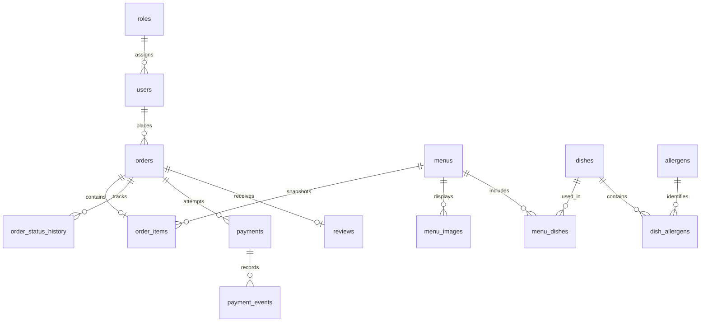

# Vite et Gourmand database

## What is included

This Symfony scaffold uses PostgreSQL 16. The initial Doctrine migration creates
22 tables, adapted from the earlier `ECF/Codex help` database in this workspace,
with payment tracking added. The initial seed contains only reference data;
subsequent migrations add administrator and screenshot demonstration accounts.

## Screenshot account import (17 November 2026)

### Subsequent employee position and login update

Migrations `Version20261117190000` and `Version20261117190100` add
`staff_positions` with departments, responsibilities and service contexts for
the nine requested catering positions, plus the existing Cuisine and Livraison
functions. The employee administration page uses this catalogue for its form
and displays responsibilities alongside each employee.

Hugo Martins is assigned Chef cuisinier / Traiteur; Sofia Lemaire retains
Livraison. Their schedules and account IDs are preserved. Eight fictional sample
employees fill the remaining positions: Lucas Moreau (Second de cuisine / Commis),
Camille Dubois (Directeur de salle), Antoine Laurent (Maître d’hôtel), Emma Petit
(Chef de rang), Louis Roux (Serveurs / Extras), Chloe Garnier (Barmans / Mixologues),
Gabriel Faure (Sommelier), and Manon Chevalier (Hôtes / Hôtesses d’accueil).

All ten use lowercase `firstname.lastname@gmail.com` login identifiers and the
user-requested initial password pattern `FirstnameEmploye12345!`. Only password
hashes are stored in the database. These are application accounts; no Gmail
mailboxes were created or verified. Customer and administrator credentials are
unchanged. The employee email/password details below describe the earlier import
and are superseded by this update. All ten password hashes and position
assignments were verified after migration.

Migration `Version20261117180000` adds the following profiles without replacing
existing accounts with the same email:

| Profile | Role/function | Contact details | Schedule | Demo open tasks |
| --- | --- | --- | --- | --- |
| Sofia Lemaire | Employee / Livraison | `sofia.lemaire@example.invalid` (placeholder) | Lun – Ven, 8 h – 16 h | 2 |
| Hugo Martins | Employee / Cuisine | `hugo.martins@example.invalid` (placeholder) | Mar – Sam, 7 h – 15 h | 4 |
| Lucie Bernard | Customer | `lucie@exemple.fr`, `06 00 00 00 00`, Bordeaux Caudéran | — | — |

Julie already has an administrator account; its credentials are preserved.
Missing street addresses, postal codes and employee phone numbers are empty.
The employee emails are reserved placeholders because none appear in the images.
Each new account receives a hash of an independent random, undisclosed password;
the masked password in the screenshot cannot be recovered. Set real credentials
before using these accounts to sign in. Email verification remains unset.

`demo_open_task_count` records only the screenshot counts, not live tasks.
The abbreviated C. Martin and Enterprise Atlas order labels are not imported as
accounts: their account identities/contact details are not supplied. Order dates
lack a year, so no orders or delivery assignments are invented by this import.

| Component | Tables | Purpose |
| --- | --- | --- |
| Accounts | `roles`, `users`, `password_reset_tokens` | Customers, employees, administrators and password recovery |
| Menu catalogue | `menus`, `themes`, `diets`, `menu_diets`, `menu_images` | Prices, minimum guests, stock, publication, filters and gallery |
| Dishes | `dish_types`, `dishes`, `menu_dishes`, `allergens`, `dish_allergens` | Reusable dishes and allergen information |
| Orders | `orders`, `order_items`, `order_statuses`, `order_status_history` | Delivery address, price snapshots and progress history |
| Payments | `payments`, `payment_events` | Provider references, payment attempts, refund totals and webhook deduplication |
| Reviews | `reviews` | One moderated rating per order; author comes from the order |
| Business information | `opening_hours`, `contact_messages` | Weekly hours and contact enquiries |

Reference seeds contain roles, themes, diets, dish types, allergens and order
statuses. Edit these via subsequent migrations once this migration has been run.



## Start and create the database

Prerequisites: PostgreSQL 16 (or Docker Compose) and PHP with `pdo_pgsql` enabled.
The existing local `.env` connection matches the Compose defaults. The development
Compose override binds PostgreSQL to localhost port 5432.

```powershell
# Start only the database service using the existing compose files.
docker compose up -d database
docker compose ps database

# Verify the PHP driver, then apply the migration.
php -m | Select-String pdo_pgsql
php bin/console doctrine:migrations:migrate --no-interaction
php bin/console doctrine:migrations:status
```

With an existing PostgreSQL installation, put its connection URL in `.env.local`
and run `php bin/console doctrine:database:create --if-not-exists` before migrating.
The database account must be able to install the `citext` extension, used for
case-insensitive unique emails. Set actual credentials in `.env.local` rather
than committing them. If port 5432 is occupied, change the host port in
`compose.override.yaml` and the URL in `.env.local` together.

The migration is transactional. It deliberately has no destructive rollback;
restore a database backup when a rollback is necessary. Retain the SQL files
alongside the migration in deployments and do not change them after application.

### Alternative: direct SQL installation

For a fresh database without Doctrine migration tracking:

```powershell
psql -h localhost -U app -d app -v ON_ERROR_STOP=1 -f database/postgresql/001_schema.sql
psql -h localhost -U app -d app -v ON_ERROR_STOP=1 -f database/postgresql/002_seed_reference_data.sql
psql -h localhost -U app -d app -v ON_ERROR_STOP=1 -f database/postgresql/003_payments.sql
```

Choose one installation method. Do not run the initial Doctrine migration after
installing the same tables manually. The Doctrine method is preferred for this app.

## Application integration and business rules

Doctrine entities in `src/Entity/` map accounts, the menu catalogue, orders,
order history, payment attempts and reviews. Symfony loads users by email.
Login, checkout and payment processing still require application code. Until all tables are
mapped, do not run `doctrine:schema:update --force` or apply generated migration
diffs blindly: Doctrine may propose removing the unmapped tables.

- Map database roles `user`, `employee`, `administrator` to Symfony roles
  `ROLE_USER`, `ROLE_EMPLOYEE`, `ROLE_ADMIN`. This schema uses one primary role per
  account. Authorization and role inheritance still belong in Symfony security.
- Hash passwords with Symfony's password hasher. Store only a SHA-256 digest of
  each random reset token; enforce expiry and consume it atomically on use.
- One menu per order is the inherited project assumption, enforced by the unique
  `order_items.order_id`. Create the header and its item in one transaction.
- Menu prices represent the minimum group price. Snapshot the final per-person
  price, guest count, menu title and delivery address when ordering. Use decimal
  arithmetic, with an explicit rounding policy; SQL money values are `NUMERIC`.
- Check stock and reserve it atomically in the order transaction to avoid
  overselling. Confirm whether stock represents orders or portions before
  implementing booking. Also enforce availability, lead time and discount rules.
- Database checks enforce nonnegative amounts, minimum guests, valid statuses,
  ratings and order total arithmetic. The application must reconcile the order
  subtotal with its item, enforce allowed status transitions, and write history
  together with each status change.
- Only allow the customer owning a completed order to review it. The database
  enforces one review per order and ratings from 1 to 5; completion and moderation
  permissions require application checks.
- Payments use integer minor units (EUR cents). Verify provider signatures and
  reconcile provider amounts/currency with the order before marking it paid.
  Process each event and its state changes in one transaction. No card numbers,
  security codes or raw provider payloads are stored. Refund/provider integration
  and rules preventing duplicate successful charges remain application work.
- Archive menus and deactivate users referenced by orders instead of deleting
  historical sales. Customer deletion/anonymisation needs an explicit workflow.

Equipment lending details, a separate analytics database, and notification jobs
are not included in this initial schema. The inherited order statuses include
equipment return tracking; add an equipment model if the final brief requires it.

## Verification on this workstation

The migration passes PHP syntax checking and Symfony container linting. A live
migration could not be tested: the command-line PHP has no PostgreSQL PDO driver,
and Docker is not available on PATH. After installing those prerequisites, run
the migration and status commands above against a fresh development database.

## Statistiques administrateur et notifications

La page /administration/statistiques utilise MongoDB pour agréger les commandes par menu et le chiffre d’affaires. Chaque consultation copie un instantané des commandes PostgreSQL dans la collection admin_order_snapshots, puis exécute les filtres et agrégations dans MongoDB. Les instantanés sont isolés par identifiant pour les consultations simultanées et expirent après 24 heures. Ils contiennent uniquement les identifiants de commandes et menus, dates de prestation, statuts et montants.

Installer les dépendances avec npm ci. Node.js et MongoDB doivent être disponibles sur le serveur PHP. Les paramètres Symfony MONGODB_URI (par défaut mongodb://127.0.0.1:27017), MONGODB_DATABASE (vite_gourmand_statistics) et NODE_BINARY (node) peuvent être définis dans .env.local. Le compte MongoDB doit pouvoir écrire, créer les index et agréger cette collection.

Les commandes annulées sont exclues du comptage. Le chiffre d’affaires correspond aux commandes terminées, après réduction et hors livraison. Les dates de filtre sont celles des prestations, bornes incluses. Le schéma actuel impose un seul menu par commande.

La création d’un employé enregistre son compte et sa notification dans une transaction PostgreSQL. Le mail contient l’identifiant et demande de contacter l’administrateur pour obtenir le mot de passe. Il ne contient jamais ce mot de passe. Configurer MAILER_DSN et MAIL_FROM_ADDRESS dans .env.local pour permettre l’envoi réel. Les envois non confirmés restent dans employee_mail_outbox et peuvent être relancés depuis la liste des employés ou avec php bin/console app:employee-notifications. Un arrêt après acceptation du mail par le serveur SMTP mais avant validation en base peut entraîner une nouvelle livraison lors de la relance.

### Mailpit et Gmail

En développement, .env.dev.local configure SMTP sur 127.0.0.1:1025. La boîte Mailpit est consultable sur http://127.0.0.1:8025. Pour démarrer la version Windows installée localement : var/tools/mailpit/mailpit.exe --listen 127.0.0.1:8025 --smtp 127.0.0.1:1025 --database var/mailpit.db --disable-version-check. Une alternative est docker compose up -d --no-deps mailer lorsque Docker Desktop fonctionne.

Pour Gmail en production, compléter et décommenter les deux lignes dans .env.prod.local. Utiliser l’adresse Gmail comme identifiant SMTP (avec @ encodé en %40), un mot de passe d’application Google sans espaces et smtp.gmail.com sur le port 465 avec smtps. MAIL_FROM_ADDRESS doit correspondre au compte Gmail choisi. Le mot de passe d’application nécessite la validation en deux étapes du compte Google. Les fichiers .env.*.local sont exclus de Git. La production doit fonctionner avec APP_ENV=prod pour sélectionner cette configuration.

Un test local peut être envoyé avec php bin/console mailer:test test@example.invalid --from=VOTRE_ADRESSE@gmail.com. Les notifications déjà capturées par Mailpit sont considérées comme envoyées et ne seront pas renvoyées automatiquement par Gmail.
